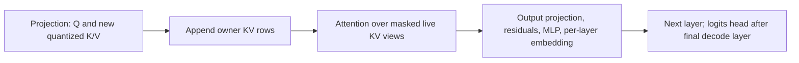

# Native Gemma4 runner: improvements and implementation status

This document summarizes the local Gemma4 E2B work built on
`~/src/LiteRT/tensor` and this checkout's `litert/tensor` API. The result is a
C++ model runner that authors tensor expressions and executes them directly
through XNNPACK. LiteRT-LM CPU is the comparison baseline; the native inference
executable does not link the LiteRT-LM executor or the LiteRT interpreter.

The main improvements are matching the published model's quantization,
attending over live INT8 KV rows, reusing smaller prefill chunks, preserving
original INT2 weights, and sharing scratch across serialized execution stages.
The live-KV version improved measured phone performance. The subsequent memory
changes reduced RSS substantially, with a QC2 performance tradeoff that depends
on the CPU. These are local testing implementations, with the newest work still
in experiment directories rather than integrated into either repository.

## What we started with, and where the changes are

The existing [LiteRT Gemma4 example][litert-example] already supplies E2B/E4B
configuration, transformer and shared-KV graph construction, RoPE helpers,
quantized embeddings, safetensor loading, and separate prefill/decode runners.
This checkout already supplies tensor expressions, graph conversion, XNNPACK
lowering, borrowed buffers, dynamic input reshaping, and a weights-cache hook.
Those foundations were reused. XNNPACK's mixed-precision BMM fusion, QC2
kernels, and shared-workspace API also already existed.

| Location | Current status and role |
| --- | --- |
| [`~/src/LiteRT/tensor`][litert-tensor] | Source of the copied model examples. No local changes in this subtree at the review snapshot. Its driver uses FP32 host KV, graph concatenation, and a prefill graph sized to the supplied prompt. |
| [This checkout's runner](runners/xnnpack/runner.h) | Tracked local edits add runtime-flag plumbing and regression tests. Shared workspace and the new cache manager are not additions to this class. |
| [This checkout's examples](examples/gemma4/README.md), [CMake build](CMakeLists.txt), and [Android launcher](../../scripts/run-litert-tensor-tests-android.py) | Local untracked additions: copied/adapted examples, mobile checkpoint support, diagnostics, and a standalone build/test path. |
| [Matched-bundle adapter][matched-guide] | External local adapter that imports the actual LiteRT-LM bundle's coefficients and quantization. Its early fixed-capacity INT8 banks and 128/1024-row prefill selection were an intermediate implementation. |
| [Live-KV v4][live-guide] | External staged runner with one INT8 bank, active attention views, and repeated prefill chunks. This is the performance baseline for the later memory work. |
| [Memory candidate][memory-guide] | External extension of v4 with optional compact static INT2 weights and shared scratch. Both optimization flags default to false and were enabled explicitly for the combined candidate. |

Do not transfer an intermediate adapter limitation to the original LiteRT
example or XNNPACK itself. In particular, LiteRT's `SetInput` already supports
borrowed buffers; binding an entire cache prefix is not by itself a memcpy.
The full-bank update algebra removed below belonged to our earlier matched
INT8 adapter. The repository example's FP32-KV/CT-checkpoint results also remain
separate from the later matched-bundle correctness results.

The review used XNNPACK HEAD `bf3ee43b63070284f85a4a882f298b6ca5273f01`
and LiteRT HEAD `0a3b74ca2a4f7deec1fe2b2f63e0e950663d9a0d`, plus local files.
The [source-state record][source-state] captures that distinction. Frozen
experiment manifests identify the actual sources and binaries used for results;
the checkout HEAD alone does not reproduce them.

## Improvements in the checkout

### Standalone builds, model loading, and diagnostics

The [tensor CMake project](CMakeLists.txt) builds the existing tensor libraries
and tests on Linux and Android, with an optional Gemma4 example. The
[example build](examples/CMakeLists.txt) removes the copied driver's TFLite mmap
weight-cache helper and Perfetto dependencies, using XNNPACK's weights-cache
API directly. It links the tensor/XNNPACK libraries and supporting dependencies.
The [Android test launcher](../../scripts/run-litert-tensor-tests-android.py)
selects an explicit device, checks executable architecture/dependencies, and
collects exit codes, GoogleTest XML, logs, and skip reasons in a fresh directory.
Build/test commands remain in [the tensor README](README.md#build-and-test).

The copied [safetensor loader](examples/utils/safetensor_loader.cc) was adapted
to mobile compressed-tensors metadata, mixed 2/4/8-bit weights, packed shapes,
and static activation scales. [Embedding lookup](examples/gemma4/helpers/quantized_embedding.cc)
validates storage and quantization metadata and converts/dequantizes requested
rows. [MobileFullyConnected](examples/gemma4/helpers/mobile_fully_connected.h)
preserves explicit static INT8 input/output quantization. The initial CT model's
output head uses a [local FP32-activation FC lowering](examples/gemma4/helpers/float_activation_fully_connected.cc).
That head is distinct from the matched bundle's dynamic QD8/QC2 head below.

Raw token-ID input, full-logit and intermediate dumps, and
[comparison tools](examples/gemma4/compare_logits.py) make failures
reproducible. The latest recorded checkout CMake suites with examples report
652 cases on Linux and Android: 626 passed and 26 skipped. These synthetic
tests do not establish full-model replacement correctness.

### Runtime flags and the E2B broadcast workaround

[`XnnpackRunner::Create(outputs, runtime_flags)`](runners/xnnpack/runner.h)
now forwards flags to runtime creation, defaults to zero, and retains them
across moves. [Tests](runners/xnnpack/runner_test.cc) cover that behavior.
The example uses this to expose `XNN_FLAG_SLOW_CONSISTENT_ARITHMETIC` as an
optional numerical diagnostic.

E2B has one KV head. Its [attention helper](examples/gemma4/helpers/attention.h)
now lets BMM broadcast that head directly instead of creating an explicit
Tile/broadcast node. This avoids the unsupported explicit-broadcast path
encountered when consistent arithmetic disables an optimizer rewrite. It is a
model-graph workaround, not a general XNNPACK broadcast-kernel fix. E4B's
multiple-KV-head path still needs separate treatment for that diagnostic mode.

## Matching the actual LiteRT-LM model

The original mobile CT checkpoint and the published `.litertlm` bundle are
not interchangeable correctness/performance inputs. The [matched loader][matched-loader]
imports the bundle's active integer coefficients, FP32 coefficients, and scales.
The [bundle-specific operations][matched-ops] and attention helpers preserve:

- Static activation-quantization boundaries and the global quantized per-layer
  embedding projection, including its slicing and normalization order.
- The CPU head's dynamic QD8 activations and original QC2 weights.
- Actual INT8 K/V storage with the published owner scales and zero points;
  current K/V are quantized before their first attention use.
- RoPE positions, head/row layout, local-window masks, and cache-only prefill
  followed by the reserved final prompt token's full decode.

This is model adaptation and lowering work, rather than a new quantization
scheme. The comparison harness supplies identical raw prompt and teacher-forced
continuation IDs, keeping histories fixed even when predictions differ.
FP32 intermediates near static activation-quantization thresholds made
small differences in RoPE or BMM arithmetic visible in later logits. Isolated
operation replays, provider-RoPE controls, fusion controls, and stage traces
helped locate these differences; they did not demonstrate a different
quantizer rounding rule.

For a current CPU baseline, the [separate PR #9918 rebuild][pr9918-guide]
updated LiteRT-LM's effective dependencies as well as LiteRT's. Both the updated
baseline and native runner execute fused FP32/QCINT8 attention, avoiding the
historical baseline's materialized FP32 KV temporary. The fusion was existing
XNNPACK functionality; PR #9918 provided an upgrade route from the old binary.
That rebuild lives in separate worktrees and does not modify `~/src/LiteRT/tensor`.

## Live KV storage and reusable prefill

### One bank with token-major K and V

The early matched adapter used two alternating INT8 banks, K stored as
`[capacity,D]`, and V as `[D,capacity]`. Full-bank graph updates and separate
local-window gathers consumed work beyond the newly appended tokens.

[`ActiveKvBank`][kv-bank] now owns one persistent bank with both K and V stored
as `[capacity,D]`. Appending copies only the new rows. Attention borrows a
contiguous prefix or local-window view, and shared-KV layers refer to their
owner's storage. Fifteen owners need 30 allocations: **18 MiB at capacity 2048**,
plus overread padding, rather than two logical 18 MiB banks.

`BeginAppend`, `Append`, `Commit`, and `Abort` control visibility and keep a
failed append from advancing committed history. Reset invalidates history
without clearing storage. Padded views can therefore contain stale bytes;
causal/window masks must exclude every invalid position.

### Compute follows live history

[`RunLiveTokens`][memory-main] reshapes attention inputs to the active extent.
Global attention rounds the live length up to a multiple of 32. Local attention
rounds window boundaries outward and masks the padding; single-token decode
with a full 512-token window uses 512 or 544 positions. Allocation capacity and
attention width are separate. XNNPACK still performs internal adaptation and
packing of the active operands; this does not eliminate all KV memory traffic.

Alignment 32 preserves efficient borrowed views and the tested numerical
behavior. Shape changes can change FP32 accumulation and later quantization,
so alignment is an empirically validated configuration rather than a universal
bitwise-equivalence guarantee.

### Repeat smaller prefill chunks

The early matched adapter selected one 128-row or 1024-row prefill call. A
512-token prompt therefore executed a padded 1024-row graph. The new scheduler
reuses a 128-row prefill signature across multiple calls, with absolute RoPE
positions and masks for each chunk. Only the final partial chunk pads rows.
The chunk size is selected when constructing the runtimes: 128 by default,
or 1024 through the driver option; that signature is then reused.
For a 512-token prompt, 511 prefix tokens use four calls; the reserved last
token runs through decode to produce first logits.

Cache-only prefill stops after the last distinct KV owner's K/V production.
The staged graph audits 129 FC/28 BMM nodes for prefill versus 277 FC/70 BMM
for full decode. It avoids computing unused later-layer outputs and vocabulary
logits for every prefix row. Prefill chunk size, live attention width, and
allocation capacity are independently controlled.

## Staged execution and memory reductions

The [graph-boundary helpers][graph-cuts] expose projection, new K/V, attention,
and post-attention tensors. The driver runs each stage in dependency order:

[`StageRunner`][stage-runner] extends the existing `NnpackRunner` with borrowed
thread-pool, packed-weight-cache, and optional workspace handles. Stage outputs
remain separate owning buffers and feed later stages through borrowed views.
Preparation and complete invocations are serialized. All stages must be
destroyed before their borrowed resources, and model storage must outlive use.

| Change | Before | Implemented result |
| --- | --- | --- |
| Preserve original static INT2 MLP weights | 60 gate/up/down matrices in layers 15–34 widened into QC4 storage | [Provenance-checked INT2 buffers and lowering][static-int2] preserve the same codes/scales as QC2: four coefficients per byte. Source payload falls from 540 to 270 MiB; recorded packed-weight capacity falls separately by 270 MiB. |
| Share sequential scratch | 151 stage runtimes retained private arenas totaling 197–268 MiB in the measured cases | `xnn_create_runtime_v4` attaches stages to one existing XNNPACK workspace, retaining about 8.75 MiB on TECNO or 9.13 MiB on Pixel. Persistent weights, outputs, and KV stay outside scratch. |
| Account for retained memory | Process-lifetime peak RSS obscured phase and allocation differences | [Memory snapshots][memory-snapshot] record current RSS/PSS and allocation identities at load, pack, prefill, decode, and teardown; shared aliases are counted once. |

Both memory options are explicit: `--preserve_static_int2=true` and
`--share_workspace=true`. QC2 stores two-bit weights with a scale per output
channel. Here it changes storage and kernel selection for existing two-bit
weights, with no additional precision loss. Reconstruction occurs during
loading; the recorded first-logit benchmarks exclude that load-time cost.
Workspace relocation repairs peer runtimes through existing XNNPACK machinery.
The [source audit][workspace-audit] found no routine per-stage clearing,
full-workspace copying, or repeated static-weight packing during tested decode.

## What the measurements establish

The [v4 correctness gate][live-correctness] and the separate
[combined-memory-candidate gate][memory-correctness] each pass **199/199 complete
vocabulary logit vectors bitwise** against same-phone LiteRT-LM CPU references.
Coverage includes two/four threads, repeated histories, 512-token prompts plus
64 forced decode steps, window boundaries, and histories reaching capacity
2048. Additional cache-manager, active-attention, static QC2/QC4, and shared
workspace tests exercise layout and lifetime contracts. This is strong evidence
for the tested E2B implementation, not general model-quality evaluation or
equivalence for every possible input. Earlier CT/Transformers diagnostics have
a different model contract and are not retroactively made passing.

The following numbers all come from the same [completed three-runner campaign][memory-perf],
using two threads, matched histories, 64 forced decode tokens, and six measured
sessions per runner/cell. They compare complete adapters after model loading
and compilation. Inclusive decode timing includes logit readback and validation
argmax, excluding tokenization and generation-policy sampling. First-logit time
includes session setup, prefill, and the reserved token's decode.

| Phone / prompt | LiteRT-LM decode, tok/s | Live-KV v4, tok/s | QC2 + shared scratch, tok/s | First logits, LM / v4 / combined, seconds |
| --- | ---: | ---: | ---: | --- |
| TECNO / 128 | 11.98 | 16.45 | 13.40 | 1.243 / 0.840 / 0.842 |
| TECNO / 1024 | 12.01 | 13.19 | 11.67 | 11.966 / 7.801 / 7.756 |
| Pixel 8 / 128 | 12.88 | 16.60 | 17.47 | 1.444 / 0.789 / 0.751 |
| Pixel 8 / 1024 | 12.69 | 14.16 | 14.67 | 11.108 / 7.675 / 8.003 |

The earlier, broader [v4 campaign][live-perf] found higher median decode rates
in all ten cells, by 4.3–39.3%, and lower first-logit latency. Its 512-token
cases confirm the prefill-padding penalty was removed. A separate
[capacity experiment][capacity-results] increased allocation from 256 to 4096
tokens with fixed live history: attention latency changed by +8.25% on TECNO
and −0.84% on Pixel, rather than scaling with the 16× allocation increase.
Those are separate campaigns; their medians must not be mixed with the table.

The [memory phase measurements][memory-results] show **726–797 MiB lower current
RSS** for the combined candidate than v4 after the second session's last decode.
At prompt 128 it still uses 306–381 MiB more RSS than LiteRT-LM; at prompt 1024
it is about 16–17 MiB lower in these snapshots. The remaining memory difference
was accepted for this local experiment.

The [four-configuration ablation][regression-guide] identifies QC2 as the main
TECNO regression, while shared scratch alone is approximately neutral there.
[Isolated FC probes][kernel-results] locate the difference in invocation;
[single-core tests][core-results] find QC2 slower on A715 cores in both phones
and faster on Pixel's X3. Wider NR16 QC2 kernels did not give a reliable fix
and were not adopted. These probes use actual weights with synthetic inputs;
instruction counts and timings do not establish cycle-level or DRAM-traffic
attribution. Compact storage should therefore not be presented as a uniform
decode-speed improvement.

All performance results use TECNO or Pixel 8. Normal frequency/thermal control
remained active; reports retain process/session variation. No Linux-host model
performance benchmark or Samsung/S25 test was run for these campaigns. Writing
this summary involved source and saved-result review, with no new model tests.

## Where to continue development

| Intended change | Starting point |
| --- | --- |
| Checkout API or portable build/test support | [XNNPACK runner](runners/xnnpack/README.md), [CMakeLists.txt](CMakeLists.txt), and [test instructions](README.md#build-and-test). |
| Model coefficient/quantization compatibility | [Matched loader][matched-loader], [bundle operations][matched-ops], and [static INT2 helper][static-int2]. Preserve source provenance and activation boundaries. |
| Cache layout, reset/abort, or capacity | [ActiveKvBank][kv-bank] and its [tests][kv-tests]; preserve padded-view masking and owner relationships. |
| Prefill scheduling, attention extents, or stage boundaries | [Driver][memory-main], [graph cuts][graph-cuts], and [attention overlay][attention-overlay]. Recheck full logits at affected boundaries. |
| Scratch or resource ownership | [StageRunner][stage-runner] and [workspace tests][workspace-tests]. Internal scratch cannot escape an invocation. |
| QC2 speed | [Kernel investigation][kernel-results]. Keep representation, correctness, and kernel selection separately measurable. |

The latest adapter is still a local E2B text-inference prototype. Its build
scripts reuse retained archives and overlay include paths; the checkout's
`gemma4_xnnpack_main` target does not automatically build it. Consolidating the
overlays into a reusable API, validating E4B/multimodal execution, broad model
quality evaluation, cold-start timing, and a production QC2 dispatch policy
remain outside the completed work. Existing kernels/fusion were reused; no
general XNNPACK kernel optimization was submitted as part of this experiment.

[litert-tensor]: /home/chasun/src/LiteRT/tensor
[litert-example]: /home/chasun/src/LiteRT/tensor/examples/gemma4
[source-state]: /data/bt/tmp/gemma4-native-improvements-doc-20260914/SOURCE_STATE.json
[matched-guide]: /tmp/gemma4-local-port-nggiqf9x/replacement-comparison/matched-native/README.md
[matched-loader]: /data/bt/tmp/gemma4-memory-20260913/matched_bundle_loader.h
[matched-ops]: /data/bt/tmp/gemma4-memory-20260913/overlay/litert/tensor/examples/gemma4/helpers/bundle_matched_ops.h
[pr9918-guide]: /data/bt/tmp/gemma4-pr9918/README.md
[live-guide]: /data/bt/tmp/gemma4-live-kv-20260913/README.md
[memory-guide]: /data/bt/tmp/gemma4-memory-20260913/README.md
[kv-bank]: /data/bt/tmp/gemma4-memory-20260913/active_kv_bank.h
[kv-tests]: /data/bt/tmp/gemma4-memory-20260913/active_kv_bank_test.cc
[memory-main]: /data/bt/tmp/gemma4-memory-20260913/memory-main.cc
[graph-cuts]: /data/bt/tmp/gemma4-memory-20260913/overlay/litert/tensor/examples/gemma4/helpers/active_graph_context.h
[attention-overlay]: /data/bt/tmp/gemma4-memory-20260913/overlay/litert/tensor/examples/gemma4/helpers/attention.h
[stage-runner]: /data/bt/tmp/gemma4-memory-20260913/stage_runner.h
[static-int2]: /data/bt/tmp/gemma4-memory-20260913/overlay/litert/tensor/examples/gemma4/helpers/static_int2_fully_connected.h
[memory-snapshot]: /data/bt/tmp/gemma4-memory-20260913/memory_snapshot.h
[workspace-tests]: /data/bt/tmp/gemma4-memory-20260913/stage_workspace_test.cc
[workspace-audit]: /data/bt/tmp/gemma4-decode-regression-20260914/WORKSPACE_COST_AUDIT.md
[live-correctness]: /data/bt/tmp/gemma4-live-kv-20260913/FINAL_CORRECTNESS.json
[memory-correctness]: /data/bt/tmp/gemma4-memory-20260913/CORRECTNESS.json
[live-perf]: /data/bt/tmp/gemma4-live-kv-20260913/analysis/results/SUMMARY.md
[memory-perf]: /data/bt/tmp/gemma4-memory-20260913/perf-complete-20260914/perf_results/SUMMARY.md
[capacity-results]: /data/bt/tmp/gemma4-live-kv-20260913/capacity/results/SUMMARY.md
[memory-results]: /data/bt/tmp/gemma4-memory-20260913/analysis/results/MEMORY.md
[regression-guide]: /data/bt/tmp/gemma4-decode-regression-20260914/README.md
[kernel-results]: /data/bt/tmp/gemma4-decode-regression-20260914/kernel-probe/README.md
[core-results]: /data/bt/tmp/gemma4-decode-regression-20260914/kernel-probe/SINGLE_CORE_RESULTS.md
